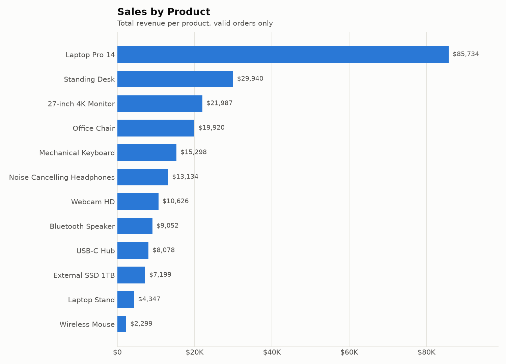
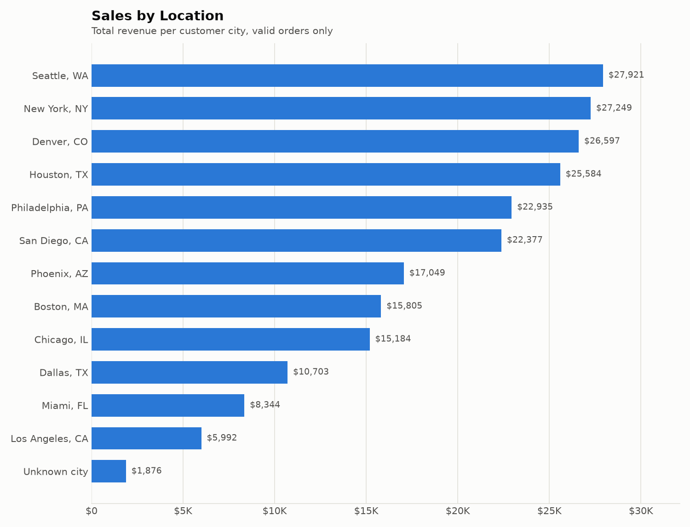
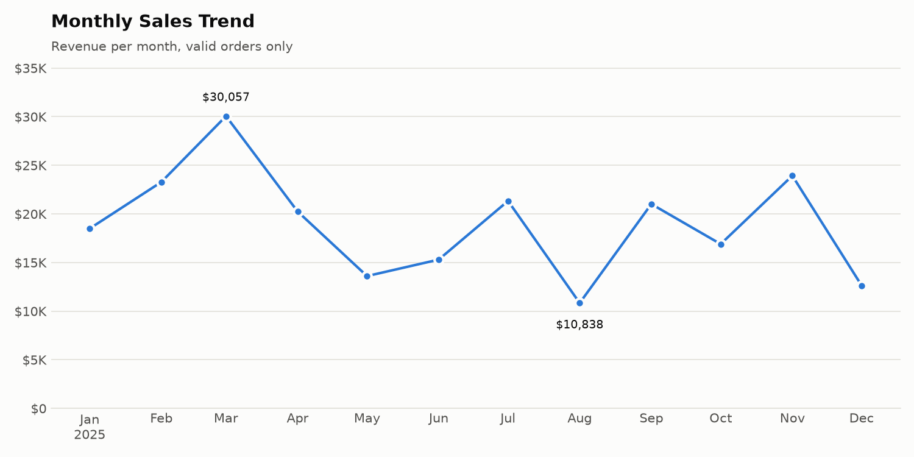
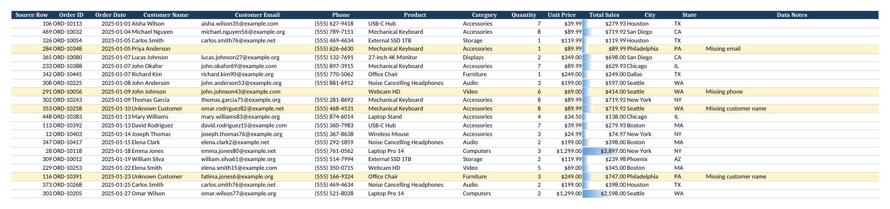
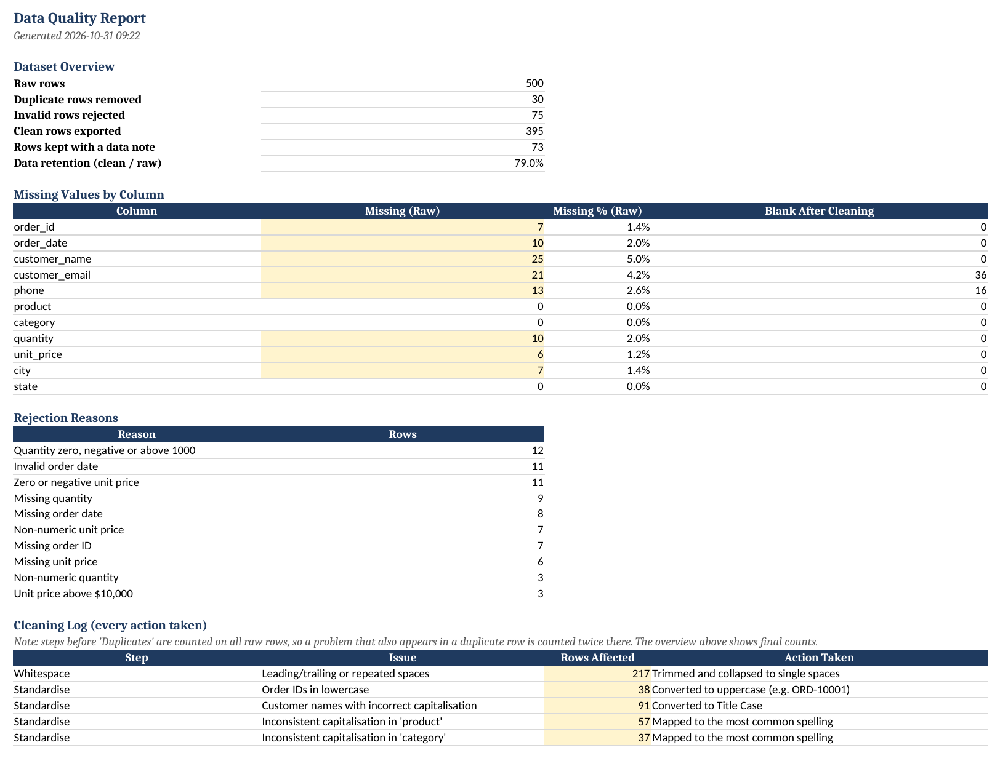
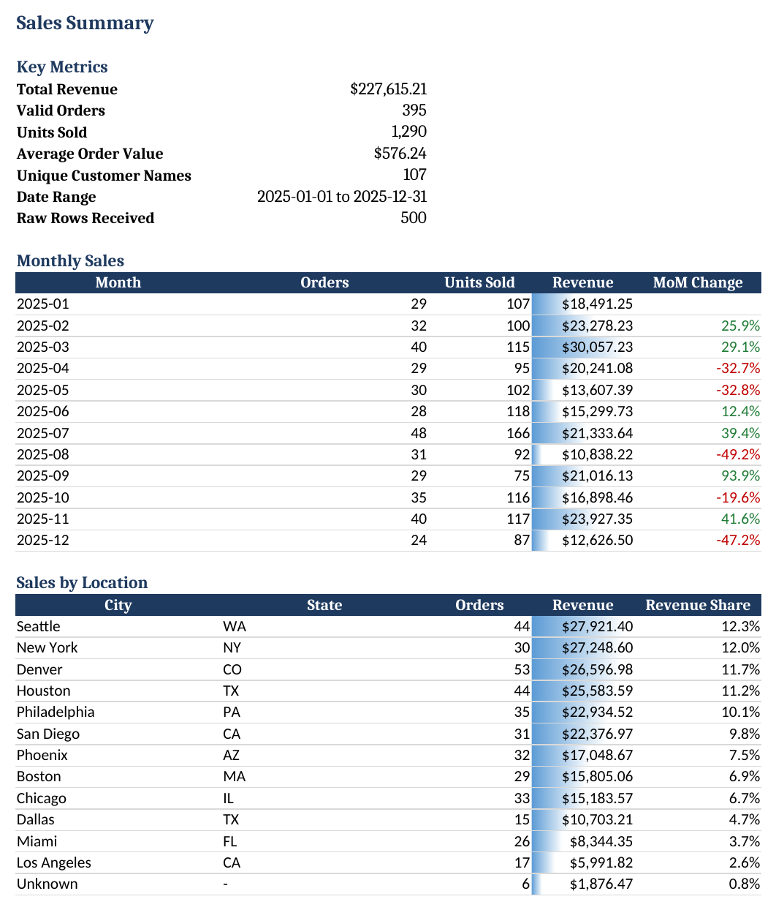
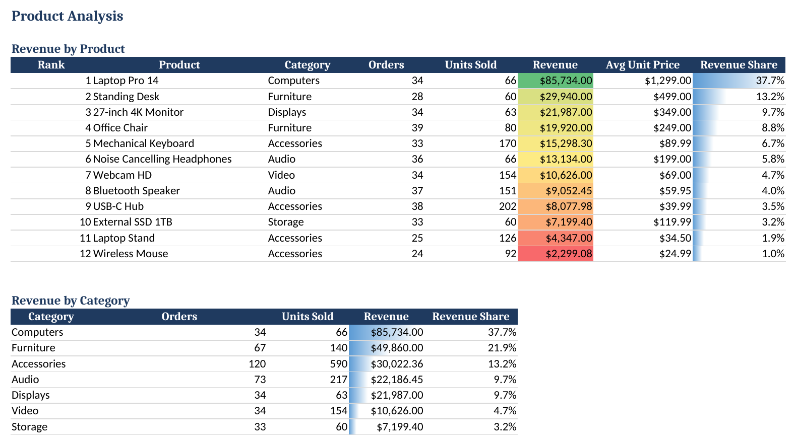
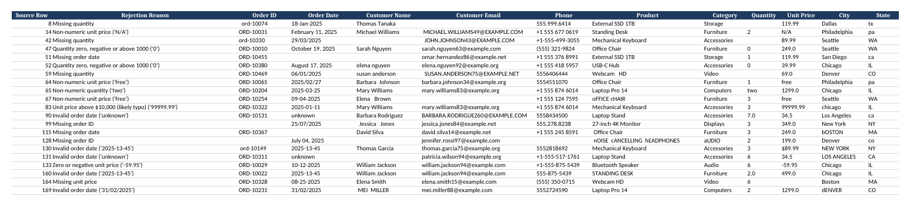

# Customer Sales Data Cleaning & Analysis Using Python and Excel

A complete pipeline that takes a **messy customer sales export** and turns it into a **clean, validated, analysis-ready Excel report** with charts. Every change is logged, and no record is deleted without a written reason.


---

## Table of Contents
- [Project Overview](#project-overview)
- [Problem Statement](#problem-statement)
- [Technologies Used](#technologies-used)
- [Project Structure](#project-structure)
- [Installation (Windows)](#installation-windows)
- [How to Run](#how-to-run)
- [Data Cleaning Methodology](#data-cleaning-methodology)
- [Excel Report Contents](#excel-report-contents)
- [Screenshots](#screenshots)
- [Results](#results)
- [Testing](#testing)
- [Limitations](#limitations)
- [Future Improvements](#future-improvements)

---

## Project Overview

This project simulates a common freelance job: a client sends a sales file exported from several systems and typed partly by hand, and needs it **cleaned, checked and summarised in Excel**.

The pipeline:

1. **Generates** 500 fictional sales records with realistic data-quality problems.
2. **Cleans** them with pandas: whitespace, capitalisation, emails, phones, dates, prices, quantities and duplicates.
3. **Separates** invalid records into their own sheet, each with a reason, instead of deleting them.
4. **Exports** a formatted Excel workbook (5 sheets), a clean CSV, a text log and 3 charts.

All names, emails and phone numbers are fictional. Emails use the reserved `example.com/.org/.net` domains and phones use the fictional `555` exchange.

## Problem Statement

Raw business data is rarely ready for analysis. The generated file contains the issues found in real exports:

| Problem | Example from the raw file |
|---|---|
| Duplicate records | Same order twice, sometimes as `John Smith` vs ` JOHN  SMITH ` |
| Missing values | Blank customer names, emails, phones, dates, quantities, prices |
| Inconsistent date formats | `2025-03-14`, `14/03/2025`, `03-14-2025`, `March 14, 2025`, `14-Mar-2025` |
| Incorrect capitalisation | `nEW yORK`, `mechanical keyboard`, `ord-10074`, `tx` |
| Extra spaces | `"  Laptop  Stand \t"` |
| Messy emails | `JOHN.DOE@EXAMPLE.COM `, `john.doeexample.com`, `john@@example.com` |
| Mixed phone formats | `555.123.4567`, `+1-555-123-4567`, `5551234567` |
| Invalid prices | `-59.95`, `0`, `N/A`, `free`, `99999.99`, `$1,299.00` (text) |
| Invalid quantities | `0`, `-3`, `two`, `2.0` |
| Impossible dates | `2025-13-45`, `31/02/2025`, `unknown` |

Without cleaning, totals are wrong, duplicates inflate revenue, and the same city or product shows up under several spellings.

## Technologies Used

| Tool | Purpose |
|---|---|
| **Python 3.10+** | Core language |
| **pandas** | Loading, cleaning, validation, aggregation |
| **openpyxl** | Excel export: header styling, column widths, number formats, filters, conditional formatting |
| **matplotlib** | Charts (PNG) |
| **pytest** | Automated tests |
| **logging** (standard library) | Audit trail of every cleaning step |

Every tool is free and open source.

## Project Structure

```
Customer-Sales-Data-Cleaning/
├── data/
│   └── raw_sales_data.csv        # messy input (generated)
├── output/
│   ├── sales_report.xlsx         # formatted Excel report (5 sheets)
│   ├── cleaned_sales_data.csv    # clean data as CSV
│   ├── cleaning_log.txt          # log of every cleaning action
│   └── charts/
│       ├── sales_by_product.png
│       ├── sales_by_location.png
│       └── monthly_sales_trend.png
├── screenshots/                  # images used in this README
├── tests/
│   └── test_pipeline.py          # 17 automated checks
├── clean_data.py                 # cleaning + analysis + Excel + charts
├── generate_dataset.py           # creates the messy dataset
├── PORTFOLIO.md                  # Upwork / Fiverr descriptions
├── requirements.txt
├── pytest.ini
├── .gitignore
└── README.md
```

## Installation (Windows)

**1. Install Python** (if you don't have it)
Download Python 3.10 or newer from [python.org/downloads](https://www.python.org/downloads/).
During installation, **tick "Add python.exe to PATH"**.

**2. Get the project**

```bash
git clone https://github.com/<your-username>/Customer-Sales-Data-Cleaning.git
```

```bash
cd Customer-Sales-Data-Cleaning
```

Or download the ZIP from GitHub, extract it, and open the folder in VS Code (**File → Open Folder**).

**3. Create and activate a virtual environment** (in the VS Code terminal: **Terminal → New Terminal**)

```bash
python -m venv venv
```

```bash
venv\Scripts\activate
```

You should now see `(venv)` at the start of the prompt.

> **PowerShell error "running scripts is disabled"?** Run this once, then activate again:
> ```bash
> Set-ExecutionPolicy -ExecutionPolicy RemoteSigned -Scope CurrentUser
> ```

**4. Install the dependencies**

```bash
pip install -r requirements.txt
```

## How to Run

Run all commands from the project root folder (the one containing `clean_data.py`).

**Step 1: Generate the messy dataset**

```bash
python generate_dataset.py
```

**Step 2: Clean, analyse and export**

```bash
python clean_data.py
```

**Step 3 (optional): Run the tests**

```bash
python -m pytest -v
```

Then open `output\sales_report.xlsx` in Excel and the PNG files in `output\charts\`.

**Options**

```bash
python generate_dataset.py --rows 1000 --seed 7
```

```bash
python clean_data.py --input data\raw_sales_data.csv --output-dir output
```

Both scripts can be re-run any number of times. Outputs are overwritten, and with the same seed the results are identical on every run.

> **"Cannot save sales_report.xlsx - it is probably open in Excel"**: Windows locks files that are open in Excel. Close the workbook and run the script again.

## Data Cleaning Methodology

Rows are tracked by their **original CSV line number** (`Source Row`), so every clean or rejected record can be traced back to the raw file.

| # | Step | What happens | Decision rule |
|---|---|---|---|
| 1 | **Load** | CSV read with every column as text | Keeps values like `$1,299.00` and `2.0` intact for inspection |
| 2 | **Inspect** | Missing values counted per column | Blank or whitespace-only counts as missing |
| 3 | **Whitespace** | Trim, collapse repeated spaces | Empty text becomes a true missing value |
| 4 | **Standardise text** | Order IDs and states to uppercase; names to Title Case | Products, categories and cities are mapped to their **most common spelling**, so `USB-C Hub` and `4K` keep their correct style |
| 5 | **Emails** | Lowercase, remove spaces, validate format | Invalid emails are removed but the **sale is kept** and flagged |
| 6 | **Phones** | Strip to digits, remove `+1`, format `(555) 123-4567` | Not 10 digits → removed, sale kept and flagged |
| 7 | **Dates** | 6 known formats parsed into one date type | Missing or impossible dates → **rejected** |
| 8 | **Quantities** | Converted to whole numbers (`2.0` → `2`) | Missing, text, ≤ 0, fractional or > 1,000 → **rejected** |
| 9 | **Prices** | `$` and `,` removed, converted to numbers | Missing, text, ≤ 0 or > $10,000 → **rejected** |
| 10 | **Required fields** | Order ID and product must exist | Missing → **rejected** |
| 11 | **Optional fields** | Missing name → `Unknown Customer`, missing city → `Unknown` | Kept and flagged |
| 12 | **Duplicates** | Removed **after** standardisation, first occurrence kept | Catches near-duplicates that Excel's "Remove Duplicates" would miss |
| 13 | **Total sales** | `quantity × unit_price` | Calculated only for valid rows |

**Why reject rather than guess?** A missing price could be filled with the catalogue average, but that would invent revenue. Rows that cannot support a correct total go to the **Rejected Records** sheet with their original values and the reason, so the client can fix them at the source. Rows with a usable sale but incomplete contact details are **kept and highlighted**.

The validation limits (`MAX_QUANTITY`, `MAX_UNIT_PRICE`) are constants at the top of `clean_data.py`, so they can be changed for each client.

## Excel Report Contents

`output/sales_report.xlsx`

| Sheet | Contents | Formatting |
|---|---|---|
| **Cleaned Data** | 395 validated orders with total sales and a *Data Notes* column | Styled headers, auto-fit widths, frozen header, filters, currency and date formats, data bars on Total Sales, **rows with notes highlighted** |
| **Data Quality Report** | Overview, missing values before vs after, rejection reasons, full cleaning log | Highlighted non-zero issue counts |
| **Sales Summary** | KPIs, monthly sales with month-over-month change, sales by location | Data bars, green/red MoM change |
| **Product Analysis** | Revenue by product (rank, units, average price, share) and by category | Red-to-green colour scale, data bars |
| **Rejected Records** | Every rejected row with its original values and the reason | Filters, frozen header |

## Screenshots

### Charts (generated by `clean_data.py`)

| Sales by Product | Sales by Location |
|---|---|
|  |  |



### Excel report

> These previews were rendered from the generated workbook with LibreOffice. Fonts and data-bar styling look slightly different in Microsoft Excel.

**Cleaned Data**: rows kept with a data-quality note are highlighted


**Data Quality Report**


**Sales Summary**


**Product Analysis**


**Rejected Records**: original values kept, each with a reason


## Results

Actual output from `python clean_data.py` on the dataset generated with the default seed (`42`):

| Metric | Value |
|---|---|
| Raw rows received | 500 |
| Duplicate rows removed | 30 |
| Invalid rows rejected (with reasons) | 75 |
| Clean rows exported | **395** (79.0% retention) |
| Clean rows kept with a data note | 73 |
| Total revenue (valid orders) | **$227,615.21** |
| Units sold | 1,290 |
| Average order value | $576.24 |

**Problems fixed automatically** (counted on all raw rows): 217 rows with extra spaces, 91 badly capitalised names, 404 non-standard dates, 416 mixed-format phone numbers, 61 messy emails and 46 prices stored as text with `$` or `,`.

**Business insights from the clean data:**
- **Laptop Pro 14** is the top product at **$85,734 (37.7% of revenue)** from only 66 units. Revenue depends heavily on one item.
- **USB-C Hub** sells the most units (202) but brings in only 3.5% of revenue.
- **Seattle** ($27,921), **New York** ($27,249) and **Denver** ($26,597) are the top locations.
- **March 2025** was the best month ($30,057) and **August 2025** the weakest ($10,838).

Note: the dataset is synthetic, so these "insights" show the analysis method rather than real market behaviour.

## Testing

`tests/test_pipeline.py` contains 17 automated checks. They run the full pipeline in a temporary folder, so they never touch `data/` or `output/`. The checks cover:

- 500 rows generated with the required columns, the same output for the same seed, and real quality problems present in the raw file
- Every raw row accounted for: `raw = duplicates + rejected + clean`
- No duplicate order IDs or rows in the clean data
- Every price > 0 and ≤ limit, every quantity a whole number ≥ 1, and `total_sales = quantity × unit_price`
- No extra spaces, one spelling per product, valid email and phone formats, real dates
- Each rejected row has a reason and does not also appear in the clean data
- All 5 Excel sheets exist, with filters, frozen header and conditional formatting
- All 3 charts saved as valid PNG files
- Repeated runs give identical results
- Clear errors for a missing input file or missing columns
- Unit tests for date parsing (all 6 formats) and phone normalisation

```bash
python -m pytest -v
```

## Limitations

- **Synthetic data.** The problems were designed in, so real client files may contain issues this pipeline does not yet handle (other languages, encodings, merged cells, multi-row headers).
- **Date formats must be known in advance.** The 6 supported formats are listed in `DATE_FORMATS`. A truly ambiguous value such as `03/04/2025` would need a client decision on day-first vs month-first.
- **Name casing is simple.** `.title()` turns `McDonald` into `Mcdonald` and `van der Berg` into `Van Der Berg`.
- **Duplicate detection is exact after standardisation.** Typos like `Jon Smith` vs `John Smith` are not matched (no fuzzy matching).
- **US phone numbers only.**
- **Static values in Excel.** KPIs are calculated in Python, not as live Excel formulas, so editing the Cleaned Data sheet will not update the summary sheets.
- **Customer count is by name**, because some rows have no email. Two different people with the same name are counted once.

## Future Improvements

- Fuzzy matching (e.g. `rapidfuzz`) for typo-level duplicates and product names
- A YAML/JSON config file for validation rules, so clients can adjust them without editing code
- International phone validation with the `phonenumbers` library
- Live Excel formulas and native Excel charts inside the workbook
- An interactive dashboard (Streamlit or Power BI)
- Reading directly from Google Sheets, a database or an API
- A command-line summary of changes compared with the previous run

---

**Author:** *Amulya.B* · [LinkedIn](#) · [Upwork](#) · [Fiverr](#)

*If this project is useful to you, consider giving it a ⭐ on GitHub.*
